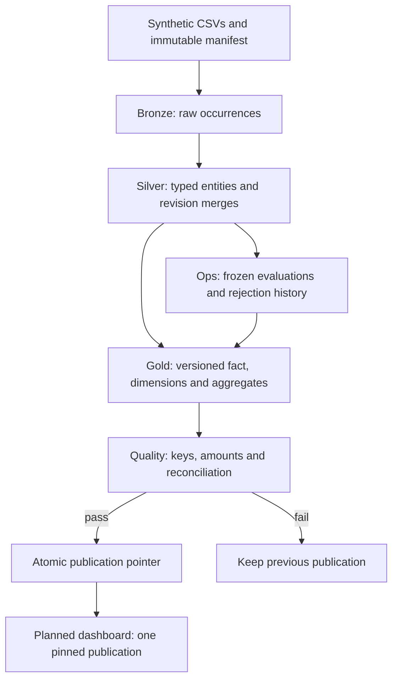

# RetailFlow — a Databricks Sales Lakehouse

**Which products and regions drive sales, and how trustworthy is the underlying data?**

RetailFlow turns deliberately messy synthetic CSVs into a dimensional sales model. Its central demonstration is a second batch containing corrections, duplicates, conflicts and invalid records: valid corrections should update sales, duplicates should not inflate them, and rejected rows should remain explainable.

**Release status · 15 October 2026:** implementation and documentation are available; **24 local tests and nine live Spark checks passed**. A six-task Lakeflow Job is deployed. **Persisted Delta behavior and the dashboard remain unverified** because Unity Catalog preflight denied CREATE SCHEMA. This is a partially verified portfolio build. [Evidence and remaining gates](docs/verification.md).

**Stack:** Databricks · PySpark · SQL · Delta Lake · Unity Catalog · Lakeflow Jobs · Databricks AI/BI dashboard specification. Data workloads run in Databricks; local Python supports development and deployment. No separate frontend.

## Start here

| Your goal | Read |
|---|---|
| Assess the project in two minutes | [Portfolio case study](docs/portfolio-case-study.md) and [verified results](docs/verification.md) |
| Review engineering decisions | [Architecture](docs/architecture.md), [data model](docs/data-model.md), [quality rules](docs/data-quality.md) |
| Reproduce or operate it | [Local quickstart](docs/quickstart.md), [deployment and recovery](docs/runbook.md) |
| See the demonstration plan | [Walkthrough](docs/walkthrough.md), [dashboard specification](dashboard/README.md) |
| Browse everything | [Documentation index](docs/index.md) |

## What this demonstrates

- **Incremental correctness:** business keys, explicit revision precedence, immutable batch identity and revision-guarded Delta merges.
- **Inspectable quality:** original raw records, multiple rejection reasons, frozen evaluation outcomes and explicit replay after a missing dimension arrives.
- **Dimensional modeling:** an order-line fact, Type 1 dimensions, transaction-price semantics and daily aggregates with explicit grain.
- **Controlled publication:** versioned Gold snapshots, reconciliation gates and one atomic pointer. Dashboard datasets pin the same registered version.
- **Engineering discipline:** deterministic fixtures, an independent oracle, behavioral tests, failure-injection specifications and candid verification boundaries.

These are implementation capabilities. Their verification levels differ; consult the [test matrix](docs/testing.md).

## Architecture



One serial job executes **preflight → bronze → silver → gold → quality → publish**. It permits one concurrent run; the operator must prevent any second writer to the same namespace. See [architecture and diagrams](docs/architecture.md).

## The correction demonstration

| Stage | Expected net sales (USD) | Units | Distinct orders | Order lines |
|---|---:|---:|---:|---:|
| Batch 1 | 55.00 | 4 | 2 | 3 |
| Batch 2: corrections and imperfect records | 91.00 | 7 | 4 | 5 |
| Missing customer arrives, without replay | 91.00 | 7 | 4 | 5 |
| Explicit replay of batch 2 | 98.00 | 8 | 5 | 6 |

These are **hand-calculated expectations**, checked by local contract simulation; they are not observed persisted Gold results. [Independent oracle](fixtures/expected.json).

Batch 2 moves one corrected line to another product, date and region. An invalid newer correction cannot replace an existing valid line. Equal-revision disagreement is quarantined. Updating a product's current price does not reprice past order lines. Arrival of customer C9 alone does not replay an earlier rejection.

## Try it locally

From the repository root, with Python 3.11 or later:

```text
python -m venv .venv
# Activate .venv for your operating system; commands below use that Python.
python -m pip install -r requirements-dev.txt
python -m pytest -q
python -m ruff check retailflow tests scripts
python -m build --wheel --no-isolation
```

No Databricks credentials are needed for local checks. They do not test Delta persistence. See [Windows and POSIX commands](docs/quickstart.md).

Deploy using the [runbook](docs/runbook.md) after arranging workspace access. The checked CLI path creates or updates one job without starting it. Optional bundle configuration is supplied; strict bundle validation was blocked in the authoring environment.

## Inspect the source

| Area | Entry point |
|---|---|
| Validation and revision decisions | [contracts.py](retailflow/contracts.py) |
| Batch manifests and occurrence identity | [manifest.py](retailflow/manifest.py) |
| Spark validation and foreign keys | [spark_transform.py](retailflow/spark_transform.py) |
| Delta persistence, rollback and publication | [pipeline.py](retailflow/pipeline.py) |
| Workflow and deployment | [job definition](resources/retailflow.job.yml), [task notebook](notebooks/task.py), [deploy script](scripts/deploy.py) |
| Behavioral and acceptance checks | [tests](tests/), [testing guide](docs/testing.md) |
| SQL metrics and dashboard layout | [dashboard](dashboard/README.md) |
| Actual execution evidence | [evidence index](evidence/README.md) |

## Scope and next milestone

V1 uses USD, Type 1 dimensions, full Gold recomputation, no deletes/returns and one writer. Driver-side CSV parsing is bounded to 10 MiB / 10,000 records per file, with one physical line per record. Spark selection rejects groups over 1,000 candidates per business key; this is not a scale benchmark. No commercial-impact claim is made.

Source: [RussypherIOIIOI/RretailfowR](https://github.com/RussypherIOIIOI/RretailfowR). The repository preserves the owner-selected [GPL-3.0 license](LICENSE).

Next: resolve scoped catalog access, execute Delta acceptance, validate dashboard SQL, and capture genuine dashboard/video evidence. [Release checklist](docs/release-checklist.md) · [limits and roadmap](docs/limitations-and-roadmap.md) · [contributing](CONTRIBUTING.md).
