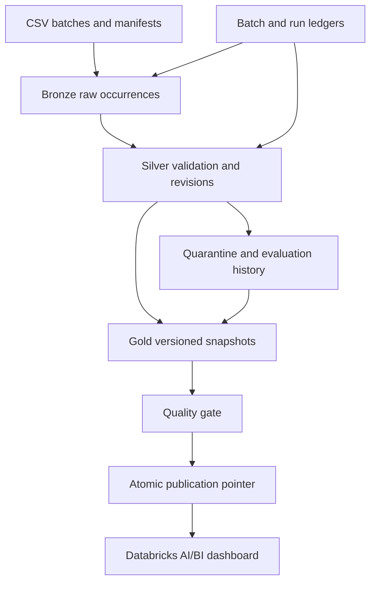

# RetailFlow — a Databricks Sales Lakehouse

**Which products and regions drive sales, and how trustworthy is the underlying data?**

RetailFlow is a compact data engineering portfolio project built around imperfect incoming data. It preserves raw evidence, validates and merges corrections, and publishes versioned sales models for a Databricks AI/BI dashboard.

**Current status:** 24 local tests pass. Nine read-only acceptance checks passed on Databricks Spark 4.2.0 / Python 3.12.3. The six-task Lakeflow Job is deployed. Full Delta integration and the live dashboard are **blocked by a missing Unity Catalog permission**, not verified. See [verification](docs/verification.md) for exact evidence.

## Demonstration

| Stage | Net sales USD | Units | Distinct orders | Order lines |
|---|---:|---:|---:|---:|
| Batch 1 | 55.00 | 4 | 2 | 3 |
| Batch 2 corrections | 91.00 | 7 | 4 | 5 |
| Missing customer arrives, explicit replay | 98.00 | 8 | 5 | 6 |

These are the hand-calculated acceptance expectations, checked by local contract simulation. They are not claimed as persisted Databricks results.

Batch 2 changes one sale's product, date and region; sends duplicates, stale updates, equal-revision disagreements, malformed CSV, and an invalid newer correction. A rejected sale is accepted only after its customer arrives and an explicit replay runs. A product price update never changes transaction prices.

## Architecture



One serial Lakeflow Job runs preflight → Bronze → Silver → Gold → quality → publish. All workload execution is in Databricks. Local Python is used for development, tests and deployment.

## Start locally

Use Python 3.11 or later. Keep the checkout path free of glob characters such as square brackets.

```text
python -m venv .venv
# Activate the environment using your operating system's normal command.
python -m pip install -r requirements-dev.txt
python -m pytest -q
python -m ruff check retailflow tests scripts
python -m build --wheel --no-isolation
```

The committed fixtures are deterministic and require no downloaded data. To regenerate in a new directory:

```text
python -m retailflow.fixtures --output generated-fixtures --seed 17
```

## Deploy and demonstrate

Follow [setup and recovery](docs/runbook.md). The checked deployment path uses the Databricks CLI and a content-addressed wheel. It creates or updates one project-owned job and does not start it automatically:

```text
python -m scripts.deploy --profile YOUR_PROFILE --catalog YOUR_CATALOG --workspace-root /Workspace/Users/YOUR_ID/retailflow
```

A parameterized `databricks.yml` is also supplied. Strict bundle validation was attempted but blocked by this agent environment's missing home configuration; it is not represented as passed.

## Repository guide

| Location | What a reviewer can inspect |
|---|---|
| `retailflow/contracts.py` | Decimal parsing, source validation, deterministic revision decisions |
| `retailflow/manifest.py` | Immutable manifests and raw occurrence identity |
| `retailflow/spark_transform.py` | Real Spark validation, FK checks and selection |
| `retailflow/pipeline.py` | Delta merges, frozen evaluations, recovery, Gold snapshots and publication |
| `fixtures/` | Two messy batches, dimension arrival, independent expected results |
| `tests/` | Local regressions, Spark checks and unexecuted Delta acceptance suite |
| `resources/`, `notebooks/`, `scripts/` | Orchestration and deployment |
| `dashboard/` | SQL datasets, filter definitions and dashboard layout |
| `evidence/` | Actual local/live checks, deployment ID and permission failure |
| `docs/` | Contracts, architecture choices, runbook, verification and walkthrough |

## Deliberate limits

Single writer per namespace, single currency, Type 1 dimensions and no deletes/returns. CSV files are bounded to 10 MiB and 10,000 records, with one physical line per record; at most 1,000 candidates per business key per evaluation. Tiny fixture parsing happens on the Databricks driver; validation and selection execute through Spark. Gold recomputes the current model fully. These choices keep the first release inspectable; they are not a claim of large-scale benchmark performance.

GitPulse, RetailFlow and IncidentLens together demonstrate application integration, reliable data engineering and evaluated applied AI. RetailFlow is intended to provide the strongest evidence for data engineering applications.
