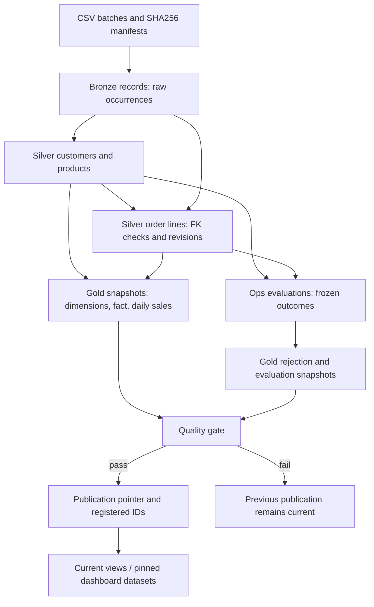

# Architecture

## Boundary and flow

RetailFlow is a bounded batch workload inside Databricks. Local tooling generates development evidence and deploys code; Databricks handles fixture generation in the managed volume, Spark transforms, Delta writes and job execution. The dashboard is specified but not created. [Current verification](verification.md).



[Editable diagram](diagrams/architecture.mmd). Arrows show dependencies; the job itself runs six serial tasks, with both dimensions processed before orders inside Silver.

| Component | Responsibility | Persisted object |
|---|---|---|
| Preflight | Set UTC, create project schemas/tables/volume, initialize fixture data and evaluation | Four project schemas; ops.runs |
| Bronze | Check manifest identity; preserve each physical occurrence | bronze.records, ops.batches |
| Silver | Normalize, validate, check FKs, freeze outcomes, apply newer valid revisions | silver.customers/products/orders; ops.evaluations |
| Gold | Recompute current model and rejection history; stage one version | Six *_snapshots tables; ops.stages |
| Quality | Check model integrity, occurrence conservation and reject threshold | ops.gates |
| Publish | Register the successful ID and move the current pointer | gold.publication |
| Dashboard | Query one registered ID consistently across datasets | SQL files supplied; live dashboard pending |

Names are relative to catalog.`retailflow_<layer>`; the prefix is configurable within the constraints in [config.py](../retailflow/config.py).

## Three kinds of identity

| Identity | Built from | Why it exists |
|---|---|---|
| Business key | Customer ID, product ID, or order ID + line ID | Select one current entity |
| Business payload hash | Canonical normalized business values; excludes revision/audit timestamp | Detect equal content independently of delivery |
| Occurrence ID | Batch ID, entity, file-byte SHA256 and physical record number | Retain provenance and make ingestion retryable |

Renaming a file within an immutable batch preserves occurrence identity. Copying it into another batch creates new audit occurrences but does not create additional logical sales. Reusing a batch ID with different bytes is rejected. Hashing is identity/integrity machinery, not authentication.

## Retry and publication boundaries

An evaluation ID fixes batch/replay scope. Each entity writes a header and its outcomes atomically into one ops.evaluations partition before Silver MERGE. Retry reuses those decisions. The guard updates a target only for a higher eligible revision. Frozen decisions deliberately prevent an infrastructure retry from silently becoming a new business evaluation.

Gold fully recomputes the current model. All six snapshots use publication_id equal to evaluation_id. Partial staging can be replaced on retry; a completed stage is reused. Current views are defined over the pointer; they return the current successful snapshot, not every staged version.

```mermaid
sequenceDiagram
    participant J as Serial job
    participant S as Silver
    participant G as Gold snapshots
    participant P as Publication row
    participant D as Dashboard
    J->>S: Validate, freeze outcomes, merge revisions
    J->>G: Write all six partitions for evaluation ID
    J->>J: Mark stage complete; run quality gates
    alt All gates pass
        J->>P: Atomically switch current ID and register history
        D->>P: Select a registered publication ID
        D->>G: Query every dataset with that same ID
    else Gate fails
        J->>J: Record failure; stop before publication
        D->>G: Continue reading prior registered ID
    end
```

[Editable sequence](diagrams/publication.mmd). The pointer and successful-ID registry share one Delta row update. **This is not a multi-table transaction.** Readers that independently query “current” can cross a publication boundary; dashboard queries must bind one registered publication ID. Old successful snapshots remain queryable while retained. Direct snapshot-table access can expose unpublished data, so consumers should use the supplied registered-ID SQL.

## Failure and rollback

Before work starts, ops.runs records the versions of all three Silver tables. An unfinished evaluation blocks a new one. Resume the same ID and scope for retry. To abandon permanently failed unpublished work, the operator explicitly restores all three tables to those saved versions. Status changes to abandoning before restore and abandoned afterward; interrupted rollback keeps new work blocked. Bronze and audit evidence remain.

The pointer is unchanged by abandonment. Published evaluations cannot use this rollback path. Retained Delta versions/files and MODIFY permission are required. [Recovery procedure](runbook.md).

## Operational assumptions

- One writer for the entire namespace, including manual notebooks. Job concurrency of one does not lock out another job.
- Files are immutable after ingestion; timestamps are audit values, not precedence.
- No schema evolution, deletes, returns, multi-currency or SCD Type 2 in v1.
- Python UDF validation and grouped collect_list selection are acceptable only within the explicit small-input bounds. The 1,000-candidate guard is checked inside the resolver after grouping; it is not a pre-shuffle memory guarantee.
- Snapshot/history retention has no automatic cleanup policy. Do not vacuum unresolved recovery versions.

[Decisions](architecture-decisions.md) · [physical model](data-model.md) · [limits](limitations-and-roadmap.md).
