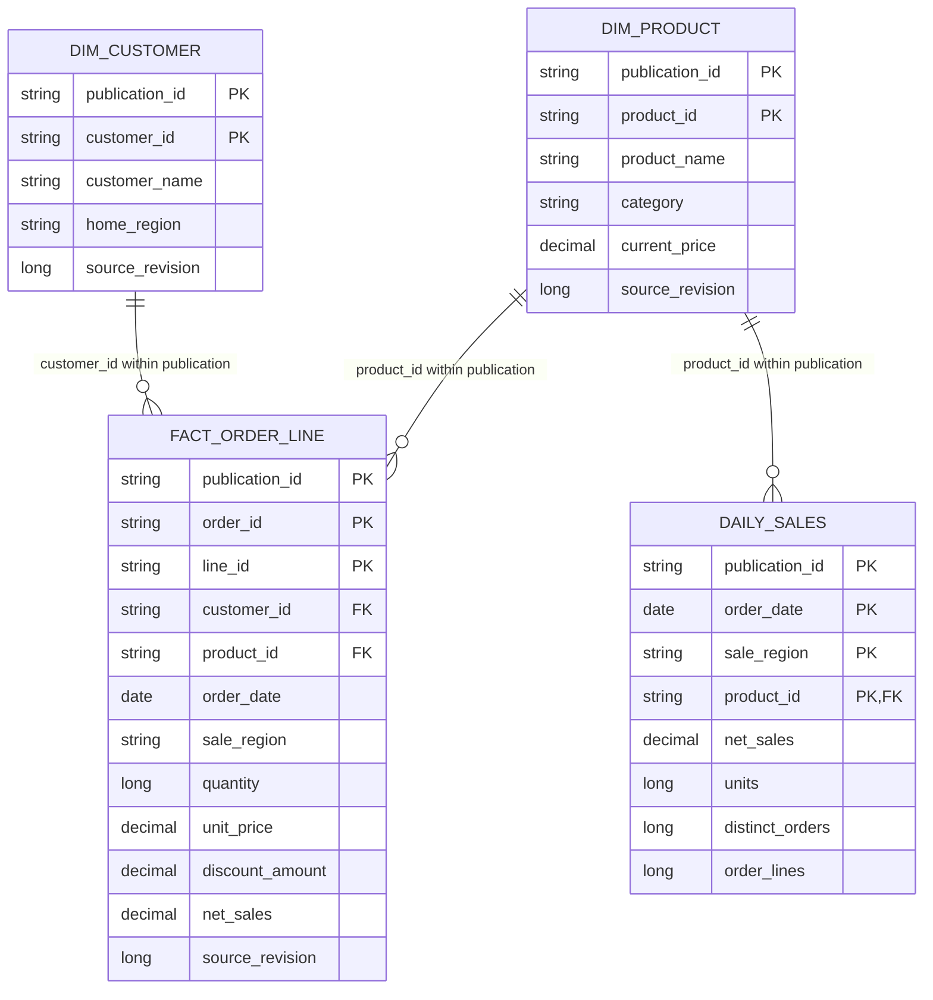

# Data model and dictionary

## Grain and relationships

The orders CSV is an **order-line feed**, not an order-header feed. Its key is (order_id,line_id). Natural keys are retained in the dimensional model; v1 does not introduce surrogate keys or a date dimension.

[Editable ER diagram](diagrams/data-model.mmd). Keys are logical uniqueness requirements validated by the pipeline, not declared enforced SQL constraints. The diagram omits audit fields. Snapshot joins include publication_id so dimensions and facts come from the same version.

## Source and typed Silver fields

CSV values arrive as strings. Valid Silver rows store explicit types. Every listed source field is required; a blank value is invalid.

| Entity | Field | Stored type | Meaning / rule |
|---|---|---|---|
| All | source_revision | BIGINT | Contract restricts to 1..2,147,483,647; whole-record replacement |
| All | source_updated_at | TIMESTAMP | Explicit-offset ISO8601 input, normalized to UTC; audit only |
| customers | customer_id | STRING | Natural key, trimmed case-sensitive ID |
| customers | customer_name | STRING | Nonblank, at most 200 characters |
| customers | home_region | STRING | NORTH / SOUTH / EAST / WEST |
| products | product_id | STRING | Natural key |
| products | product_name | STRING | Nonblank, at most 200 characters |
| products | category | STRING | Nonblank, at most 200 characters |
| products | current_price | DECIMAL(18,2) | Nonnegative current catalog price, USD |
| orders | order_id, line_id | STRING | Composite natural key |
| orders | customer_id, product_id | STRING | Must exist in current Silver dimensions |
| orders | order_date | DATE | Strict YYYY-MM-DD; 2020-01-01..2030-12-31 |
| orders | sale_region | STRING | Transaction region, uppercase allowed value |
| orders | quantity | BIGINT | Integer 1..1,000,000 |
| orders | unit_price | DECIMAL(18,2) | Nonnegative transaction unit price, USD |
| orders | discount_amount | DECIMAL(18,2) | Line discount; not a percentage or per-unit discount |
| orders | net_sales | DECIMAL(18,2) | Derived, not a CSV field: quantity × unit_price − discount_amount |

IDs accept 1–64 ASCII letters, digits, underscores or hyphens. Money rejects excess fractional precision rather than rounding. Header names and order must match [FIELDS](../retailflow/contracts.py) exactly.

Each Silver entity also stores business_key (canonical JSON array), payload_hash, payload_json (normalized validation record), occurrence_id (winning provenance) and updated_at. source_revision is stored once. JSON retains normalized evidence alongside typed columns; Gold uses typed projections.

## Physical objects

Schema shorthand below is `<catalog>.<prefix>_<layer>`. Default prefix is retailflow.

| Object | Grain / key | Fields and purpose |
|---|---|---|
| bronze.records | occurrence_id | batch_id, entity, filename, file_hash, record_index, raw_record, row_json, parse_reasons, ingested_at |
| silver.customers | customer_id / business_key | Current valid customer and metadata |
| silver.products | product_id / business_key | Current valid product and metadata |
| silver.orders | (order_id,line_id) / business_key | Current valid line and metadata |
| ops.batches | batch_id | manifest_hash/json, record_count, status, updated_at, error |
| ops.runs | evaluation_id | batch_id, replay_json, sequence, created_at, status, silver_versions_json |
| ops.evaluations | Header or occurrence within evaluation/entity | scope_id, kind, evaluation_id, entity, occurrence_id, business_key, source_revision, payload_hash/json, reasons, disposition, evaluated_at, ruleset |
| ops.stages | publication_id | sequence, status, staged_at |
| ops.gates | publication_id | passed, checked_at, report_json; latest gate result for that ID |
| ops.events | Append-only event, no uniqueness guarantee | evaluation_id, stage, status, event_at, detail |
| gold.publication | singleton=1 | current publication_id, sequence, published_at, publication_ids array of successful IDs |

ops.evaluations is partitioned by scope_id, a digest of evaluation/entity. kind='header' stores expected_count and batch scope in payload_json, not a business record. Use kind='row' for record metrics. record_index is the physical CSV line number, starting at 2 after the header.

### Gold snapshots and views

Every table below has a physical `<name>_snapshots` table partitioned by publication_id, with snapshot_created_at. Each unsuffixed name is a view selecting the current pointer. Source audit fields retained by typed() include source_revision, source_updated_at and occurrence_id. The occurrence_id links a winning fact/dimension row back to Bronze; filename and raw text remain in Bronze and rejection evidence.

| Name | Grain within a publication | Columns / meaning |
|---|---|---|
| fact_order_line | order_id + line_id | Typed orders fields including derived net_sales |
| dim_customer | customer_id | Typed customer fields, Type 1 |
| dim_product | product_id | Typed product fields, Type 1 |
| daily_sales | order_date + sale_region + product_id | net_sales, units, distinct_orders, order_lines |
| rejected_records | Ever-rejected occurrence_id | Latest active evaluation fields, first_rejected_at, last_rejected_at, resolved, raw_record, filename, record_index, batch_id, entity |
| evaluation_counts | entity + disposition | count for this publication's evaluation, not all historical evaluations |

Daily net_sales uses Spark's widened decimal SUM type; line money is DECIMAL(18,2). Exact generated schemas are defined by [pipeline.py](../retailflow/pipeline.py), including PAYLOAD_SCHEMAS and stage().

## Metric contract

| Metric | Calculation | Important boundary |
|---|---|---|
| Net sales (USD) | SUM(net_sales) from selected fact lines | Excludes tax/shipping/returns; synthetic data only |
| Units | SUM(quantity) | Additive across disjoint lines |
| Orders | COUNT(DISTINCT order_id) at the active filter grain | Never sum per-product or daily distinct counts |
| Order lines | COUNT(*) of selected fact lines | Unique composite key per publication |
| Unresolved rejected records | COUNT(DISTINCT occurrence_id) where resolved=false | Includes invalid/conflict, not duplicate/stale |
| Rejection reason count | Distinct occurrences per exploded reason | One occurrence can contribute to several reasons |
| Evaluation rejects fraction | Invalid/conflict outcomes ÷ all row outcomes in that evaluation | Across all three entities; zero rows passes threshold |

Type 1 customer/product descriptions can change. Fact unit_price and sale_region retain transaction meaning; product current_price and customer home_region must not substitute for them. The daily aggregate contains no customer_id, so customer-level filtering requires the fact.

[Quality semantics](data-quality.md) · [dashboard filters](../dashboard/README.md).
